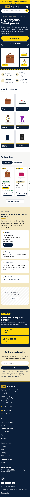

# GBG Bargain Shop – Shopify website

Online shop and product catalogue for **GBG Bargain Shop**, Unit M10, Stanley Meat Market, Prescot Road, Liverpool L13 3AS.
*Big bargains. Small prices.* – "Treasure hunt, done properly."

This repository contains everything needed to turn the existing Shopify store into the GBG shop:

| Folder | What's inside |
|---|---|
| `theme/` | The custom Online Store 2.0 theme (upload as a zip, or push with Shopify CLI) |
| `dist/` | Ready-to-upload theme zip (`npm run theme:zip` rebuilds it) |
| `scripts/` | TypeScript Admin API scripts: store setup, CSV validator, image prep, importer, weekly report, backup, DBS audit, redirects, smoke test |
| `config/collections.json` | Store structure as code: collections, rules, SEO copy, category tags |
| `templates/gbg_products_template.csv` | Product spreadsheet template (Shopify CSV format + GBG metafield columns) with filled examples |
| `notifications/` | Branded email templates to paste into Settings → Notifications |
| `content/` | Draft page copy and UK policy drafts – **[FOR APPROVAL]** |
| `analytics/` | GA4 custom pixel with Google Consent Mode v2 |
| `tests/` | Unit tests (Vitest) and end-to-end + accessibility tests (Playwright + axe) |
| `tools/preview/` | Offline design preview: renders the real theme with sample data for screenshots |
| `docs/` | Install guide, owner guide, staff SOP, setup checklist, engineering checklist (111 items), runbook, acceptance tests, handover |

**Start here →** [`docs/INSTALL_ON_SHOPIFY.md`](docs/INSTALL_ON_SHOPIFY.md) · Owner questions → [`docs/TO_CONFIRM.md`](docs/TO_CONFIRM.md) · Design review → [`docs/DESIGN_REVIEW.md`](docs/DESIGN_REVIEW.md)



---

## Setup

Requirements: Node.js 20+ (22 recommended), and for theme work the Shopify CLI (`npm i -g @shopify/cli@3`).

```bash
npm ci
cp .env.example .env      # SHOPIFY_STORE_DOMAIN + SHOPIFY_ADMIN_TOKEN (custom app, see docs/STORE_SETUP_CHECKLIST.md §1)
```

`.env` is git-ignored. Never commit tokens or paste them in chat.
A devcontainer (`.devcontainer/`) gives the same environment in VS Code / Codespaces.

## Theme development

```bash
npm run theme:check                      # Shopify Theme Check – must report 0 errors
shopify theme dev  --path theme --store <store>.myshopify.com    # local preview against real data
shopify theme push --path theme --unpublished                    # first push → new unpublished theme
shopify theme push --path theme --theme <id>                      # later pushes
shopify theme pull --path theme --theme <id>                      # pull editor changes back into Git
npm run theme:zip                        # dist/gbg-bargain-shop-theme-v<version>.zip
```

**Always work on an unpublished theme.** The live theme is only published by hand after the owner's written sign-off.

Theme structure: `layout/theme.liquid` · `sections/` (each with a schema so everything is editable in the theme editor) ·
`snippets/` · `templates/*.json` · `assets/base.css` (design tokens from Theme settings) · `assets/theme.js`
(small web components, no jQuery, deferred) · self-hosted Archivo and Inter fonts.

Key behaviours: empty collections never appear in menus or tiles · trust claims only show when switched on ·
compare-at prices only when genuinely higher · "Only 1 left" only from real stock · map loads only on click ·
newsletter prompt never on a first visit · sticky add-to-basket on mobile · condition badge + plain-English meaning.

### Offline design preview

No store needed – renders the actual Liquid with labelled sample products:

```bash
node tools/preview/render.mjs            # → tools/preview/out/*.html
node tools/preview/screenshots.mjs       # 360 / 390 / 768 / 1440 px → tools/preview/screens/
node tools/preview/states.mjs            # menu sheet, drawers, sticky bar
```

## Admin scripts

Every script writes a log to `logs/`, and every script that changes data supports `--dry-run`.

| Command | What it does |
|---|---|
| `npm run backup` | Read-only export to `backup/YYYY-MM-DD/` (products, collections, pages, menus, redirects, discounts, metafield definitions, customer *counts*) |
| `npm run audit:dbs` | Read-only: writes `docs/DBS_AUDIT.md` – every "DBS" mention with a suggested action |
| `npm run setup:store -- --dry-run` | Metafield definitions, GBG location, smart collections (**only if they'd have products**), "Collection only" shipping profile, hidden draft pages, menus. Re-runnable. `--only metafields,collections`, `--policies` (after legal approval) |
| `npm run images -- --csv products.csv` | `photos/<SKU>/*` → `prepared-images/<SKU>/<sku>-1.jpg…`: auto-orient, main image squared on white, ≤ 2048 px, compressed; alt-text drafts for review |
| `npm run validate -- products.csv --photos photos` | Checks every row (unique SKU, price, weight, condition, tested for electricals, photos, genuine compare-at, no DBS, title length, category exists); staff-readable report |
| `npm run import -- products.csv --sample 10` | Imports the first 10 products as **drafts** for owner approval |
| `npm run import -- products.csv` | Imports rows with `Status = active` as Active with stock at Unit M10. Keyed by SKU (no duplicates), skips products staff edited since the last import, failed rows → `failed_rows.csv` |
| `npm run report:weekly` | Sold-out items still featured, missing condition/alt text, old New Arrival tags (`--remove-old-tags`) |
| `npm run redirects` | Creates URL redirects from `redirects/redirects.csv` |
| `npm run smoke` | Post-deploy check of key pages on the live domain or a preview (`--base`, `--preview-theme`) |

The API client (`scripts/lib/shopify.ts`) pins the Admin API version, applies timeouts, retries with exponential
backoff on 429/5xx/THROTTLED, respects the GraphQL cost budget and refuses to call non-Shopify hosts.

## Tests and CI

```bash
npm test                 # unit tests: validator, image preparation, API client
npx playwright test      # e2e + accessibility – offline preview, or the real preview theme with PREVIEW_URL=…
npm run typecheck
```

With `PREVIEW_URL="https://<store>.myshopify.com/?preview_theme_id=<id>"` (and `STOREFRONT_PASSWORD` while the store is
password-protected) Playwright also runs the commerce flows: home → collection → filter → product → basket → checkout start,
search, sold-out cannot be added (`SOLD_OUT_PRODUCT_PATH`), collection-only label (`COLLECTION_ONLY_PRODUCT_PATH`),
pixels not firing before consent, and the no-"DBS" crawler.

GitHub Actions (`.github/workflows/`):
- **ci.yml** – every PR: Theme Check, types, unit tests, `npm audit`, DBS grep, Playwright (offline). On `main`: deploy to the
  **unpublished** preview theme (needs `SHOPIFY_PREVIEW_THEME_ID` variable + `SHOPIFY_CLI_THEME_TOKEN` secret), then Lighthouse CI
  (budgets: perf ≥ 90, a11y/BP/SEO ≥ 95, LCP < 2.5 s, CLS < 0.05) and Playwright against the preview.
- **weekly.yml** – Monday report + smoke test.
- Dependabot keeps dependencies current.

## Releases

Update `CHANGELOG.md`, bump `version` in `package.json` and `theme/config/settings_schema.json`, then `git tag vX.Y.Z`.

## Documentation

| Doc | For |
|---|---|
| [INSTALL_ON_SHOPIFY](docs/INSTALL_ON_SHOPIFY.md) | Installing the theme, emails, pixel; going live |
| [TO_CONFIRM](docs/TO_CONFIRM.md) | Every open owner question + the plan |
| [DESIGN_REVIEW](docs/DESIGN_REVIEW.md) | Colour tokens, contrast, scores, screenshots |
| [ADMIN_GUIDE](docs/ADMIN_GUIDE.md) | Owner: editing the site, products, orders, daily/weekly/monthly routine |
| [STAFF_SOP](docs/STAFF_SOP.md) · [PRODUCT_CSV_GUIDE](docs/PRODUCT_CSV_GUIDE.md) | Shop staff |
| [STORE_SETUP_CHECKLIST](docs/STORE_SETUP_CHECKLIST.md) | Click-by-click admin settings, DNS, launch day |
| [ACCEPTANCE_TESTS](docs/ACCEPTANCE_TESTS.md) | Owner sign-off |
| [ENGINEERING](docs/ENGINEERING.md) | All 111 production-engineering items, SLOs, observability |
| [RUNBOOK](docs/RUNBOOK.md) | Incidents, on-call, secrets, rollback, postmortems |
| [HANDOVER](docs/HANDOVER.md) | Versions, apps and costs, ownership, support terms |
| [TRAINING_SCRIPT](docs/TRAINING_SCRIPT.md) · [P2_ESTIMATES](docs/P2_ESTIMATES.md) · [MARKETING_CONSENT](docs/MARKETING_CONSENT.md) · [DBS_AUDIT](docs/DBS_AUDIT.md) | |
