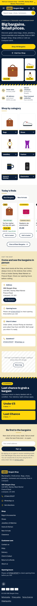
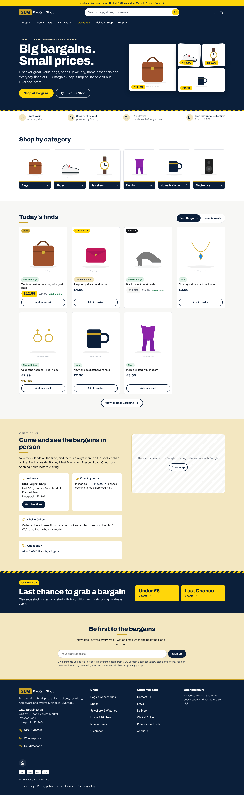
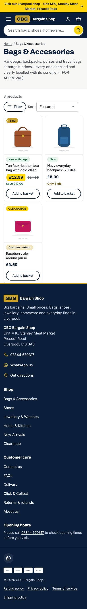
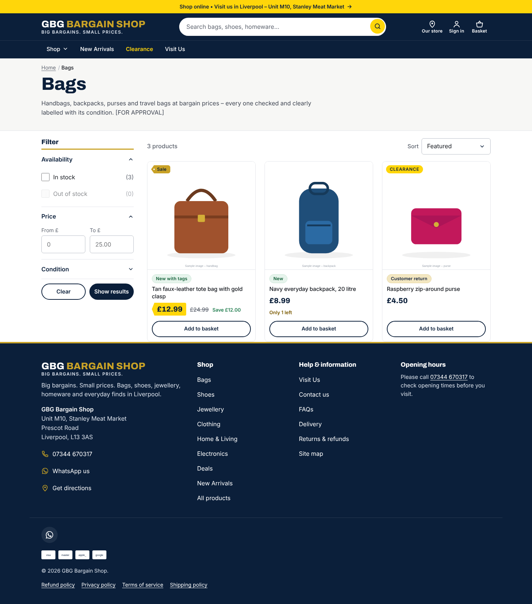
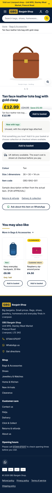
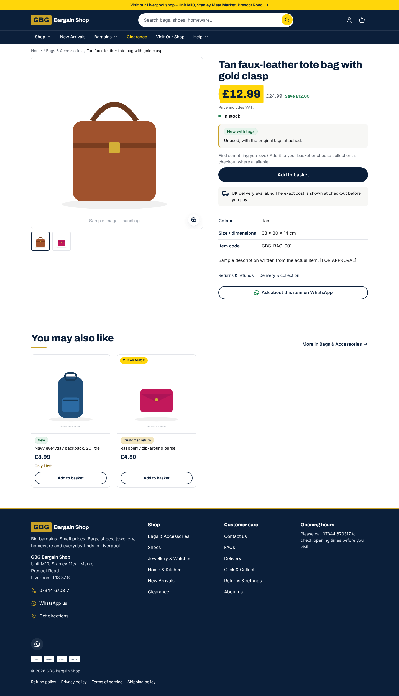
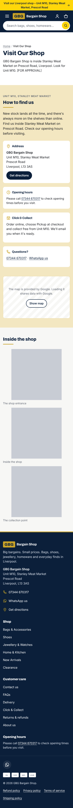
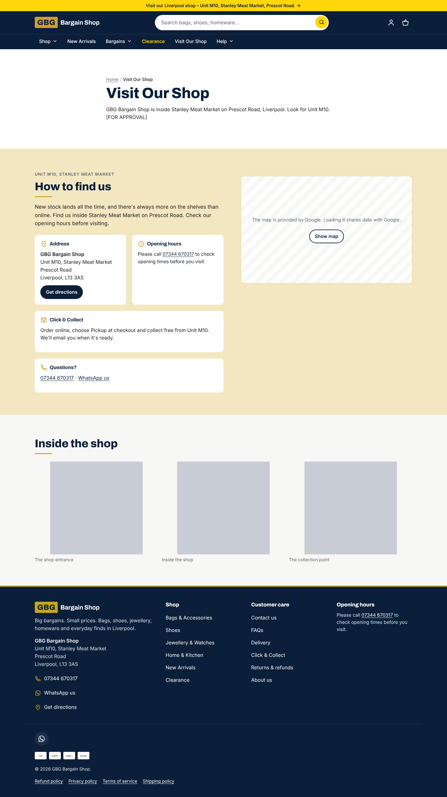

# Design review – "Treasure hunt, done properly."

Design checkpoint (brief §3.6, milestone 3). Screenshots are from the **offline preview**
(`tools/preview/`), which renders the real theme files with clearly labelled **sample** products and
illustrations. Real GBG photos replace them before launch – the brief does not allow stock photography.

**Status: waiting for owner approval of the visual direction and wording.**

## Colour tokens (for approval)

Exposed in **Theme settings → Colours**, so they can be adjusted without code.

| Token | Hex | Use |
|---|---|---|
| navy | `#0B1F3A` | Header, footer, primary buttons, headings, prices |
| navy-700 | `#153461` | Hover states, secondary surfaces |
| gold | `#C9A227` | Rules under titles, sale price-tag badge, logo mark, icons on navy. **Never small text on white.** |
| gold-soft | `#F3E7C1` | Visit Us panel, newsletter, condition panel accents |
| yellow | `#FFD60A` | **Promotion only**: sale price tag, Clearance badge, announcement bar, hero CTA. Always navy text. |
| white | `#FFFFFF` | Background, product cards |
| paper | `#F7F7F5` | Alternating sections |
| ink | `#16181D` | Body text |
| muted | `#5D6470` | Secondary text |
| success / error | `#1E7F4F` / `#B42318` | Stock and form states |

### WCAG AA contrast check (4.5 : 1 for normal text)

| Text | On | Ratio | Result |
|---|---|---|---|
| ink | white | 17.76 | ✔ |
| ink | paper | 16.56 | ✔ |
| muted | white | 5.96 | ✔ |
| muted | paper | 5.56 | ✔ |
| muted | gold-soft | 4.83 | ✔ |
| navy | white | 16.52 | ✔ |
| white | navy | 16.52 | ✔ |
| white | navy-700 | 12.38 | ✔ |
| navy | yellow | 11.70 | ✔ |
| navy | gold | 6.83 | ✔ |
| gold | navy | 6.83 | ✔ |
| navy | gold-soft | 13.38 | ✔ |
| success | white | 5.00 | ✔ |
| error | white | 6.57 | ✔ |
| gold | white | 2.42 | ✘ never used for text |
| white | yellow | 1.41 | ✘ never used |

Automated axe-core checks (WCAG 2.2 AA) run on 10 page types at phone and desktop sizes in
`tests/e2e/accessibility.spec.ts` – **0 serious or critical issues**.

## Typography

Self-hosted, open-licence (SIL OFL) fonts in `theme/assets/` – only the weights used:
**Archivo 700/800** for headings and prices (tabular figures), **Inter 400/500/600** for body and UI.
Archivo 800 and Inter 400 are preloaded. Body text is 16 px on mobile, never smaller.

## Signature details

- Gold **price-tag** shape for sale badges; genuine sale prices on a **yellow tag** (only when the compare-at price is higher).
- A thin **gold rule** under every section title.
- A diagonal navy/yellow **bargain stripe**, used only on the hero edge, clearance banner and password page.
- Real product **collage** in the hero (owner-editable), slightly rotated tiles on desktop for a "found it" feel.
- On phones, two small dots on a product card swap to the second photo (desktop: hover).
- A branded default social preview image (`theme/assets/og-default.png`) for links shared on WhatsApp, Facebook etc.
- Light motion only (fade-up, button press, drawer slide) – all off with *reduce motion*.

## Self-review scores (out of 10)

Scored against the screenshots below at 360 / 390 / 768 / 1440 px.

| Template | Hierarchy | Trust | Price clarity | Mobile usability | Speed feel | Brand fit |
|---|---|---|---|---|---|---|
| Home | 9 | 9 | 8 | 9 | 9 | 9 |
| Collection | 9 | 8 | 9 | 9 | 9 | 8 |
| Product | 9 | 9 | 10 | 9 | 9 | 9 |
| Basket (page + drawer) | 9 | 9 | 9 | 9 | 9 | 8 |
| Search / empty states / 404 | 8 | 8 | 8 | 9 | 9 | 8 |
| Visit Us / FAQ / Contact | 9 | 9 | – | 9 | 9 | 9 |

Fixed during review (each was below 8 before the fix):
- Quick-add button text wrapped onto two lines on 360 px cards → single line, smaller label.
- Desktop navigation and value strip touched the screen edge → container padding restored.
- Sold-out price used opacity, failing contrast → muted colour instead.
- Hero with no photos showed grey boxes → collage hides until real photos are added; text-only layout.
- Sticky "Add to basket" bar missed fast scrolls → scroll-position check; covered by a test.
- Footer phone link not distinguishable from text → underlined.

What would push scores higher (needs the owner): real product and shop photography, the real logo,
and real opening hours (currently a "please call" fallback).

## Screenshots

| | Phone (390 px) | Desktop (1440 px) |
|---|---|---|
| Home |  |  |
| Collection |  |  |
| Product |  |  |
| Visit Us |  |  |

More: `screenshots/` (variants, basket, empty search, 404, FAQ, contact, menu sheet, basket drawer,
filter drawer, sticky add-to-basket bar). Regenerate all sizes (360, 390, 768, 1440):

```bash
node tools/preview/render.mjs && node tools/preview/screenshots.mjs && node tools/preview/states.mjs
# → tools/preview/screens/
```
